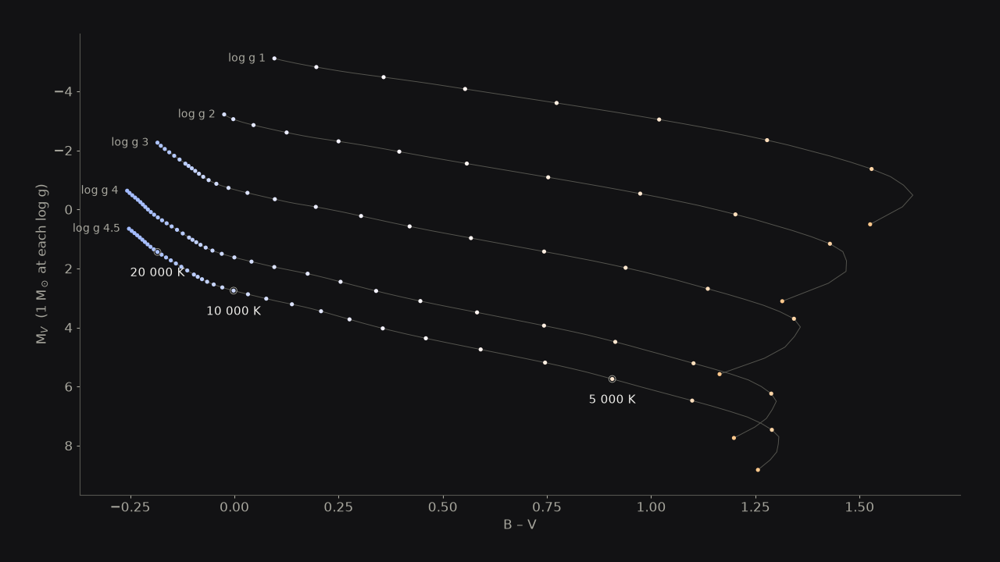
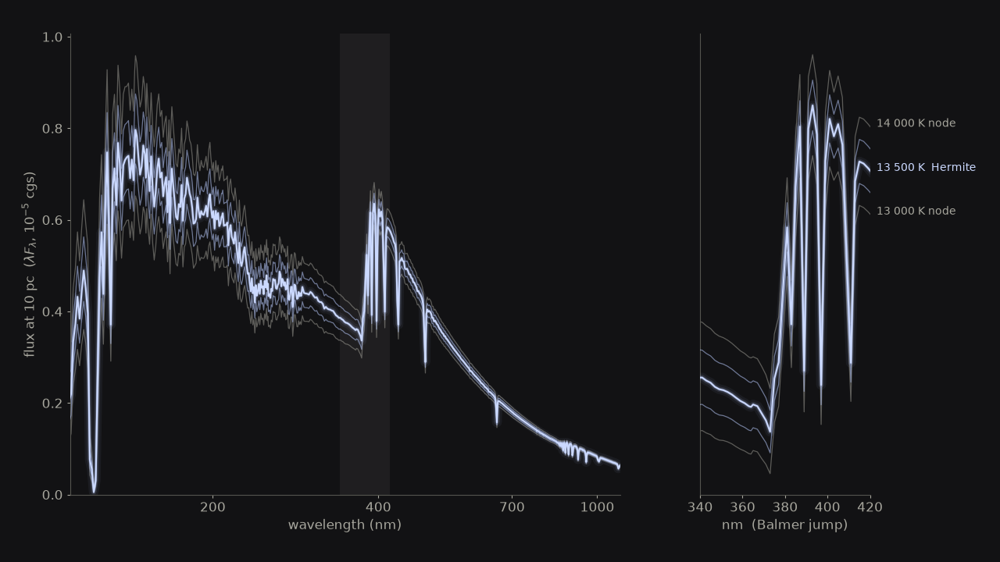
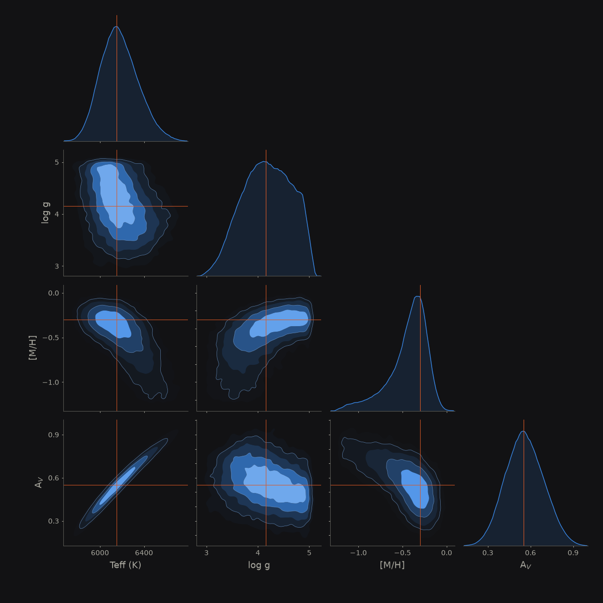
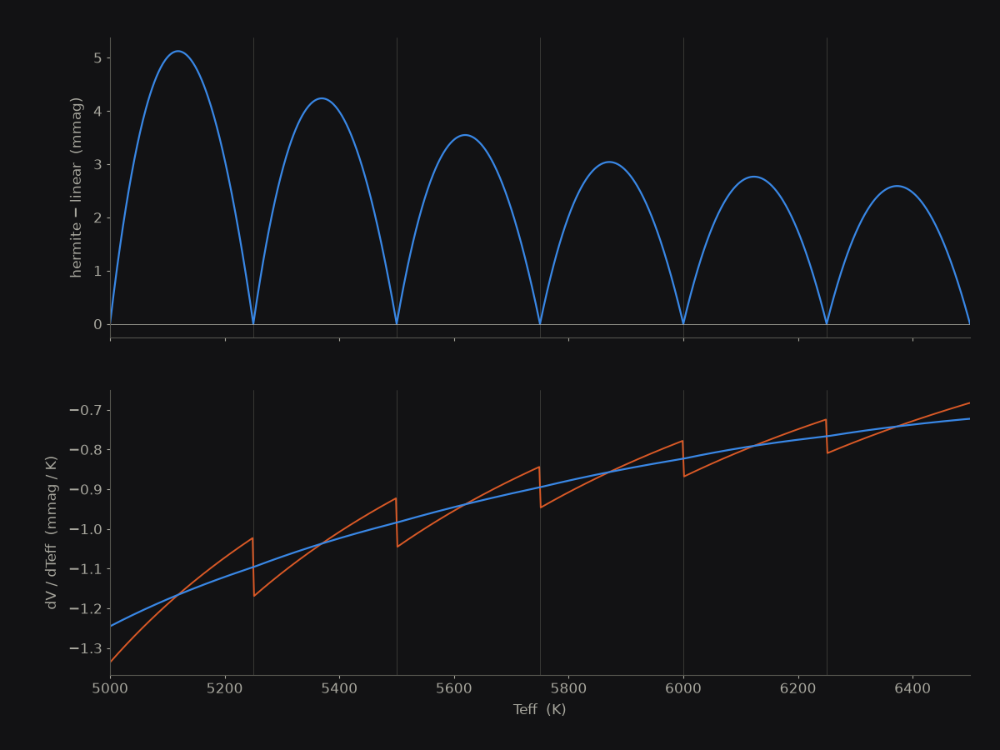

# Gallery

Plots and movies made with SED_Model. Each one is produced by a script in `demos/` that runs the package on real grids and filters; nothing is drawn by hand. The look (dark surface, three-colour palette, stars in their blackbody colour) is shared through `demos/viz_common.py`.

## Fitting a star

<video controls loop muted playsinline width="100%" poster="../assets/gallery/sed_fit_still.png">
  <source src="../assets/gallery/sed_fit.mp4" type="video/mp4">
</video>

`demos/gallery_fit.py`. A real `run_inverse` fit of synthetic UBVRI + 2MASS JHKs photometry for a known star (6150 K, log g 4.3, [M/H] −0.2). Each curve is one walker's model SED, coloured by its own Teff, so cool walkers are orange and hot ones blue. The orange points are the data. The right panel is the same walkers in the Teff–log g plane. Every frame is a real chain state; only the playback speed is warped so the early steps get more screen time.

## Heating a star

<video controls loop muted playsinline width="100%">
  <source src="../assets/gallery/star_heating.mp4" type="video/mp4">
</video>

`demos/gallery_forward.py`. `run_forward` from 3500 K to 30000 K at fixed radius. The curve is the SED (normalised to its peak) in the star's blackbody colour, the strips are Johnson U, B, V, R, I and J filters lit by the in-band flux, and the right panel follows the star along its B−V, M_V track.

| | |
|---|---|
|  |  |
| Lines of constant log g from the grid, in star colours. | The default `hermite_bounded` interpolation between the 13 000 K and 14 000 K nodes. |

## Dust

<video controls loop muted playsinline width="100%">
  <source src="../assets/gallery/dust.mp4" type="video/mp4">
</video>

`demos/gallery_extinction.py`. A 7000 K star reddened by A_V from 0 to 3 and back with the Fitzpatrick (1999) law. The grey curve is the intrinsic SED, the strips are the filter fluxes, and the right panel is the star sliding along its reddening vector. Flux is on a log axis.


## The atmosphere grid

<video controls loop muted playsinline width="100%">
  <source src="../assets/gallery/grid_walk.mp4" type="video/mp4">
</video>

`demos/gallery_grid.py`. A query point moves through the (Teff, log g) grid. Populated nodes are the bright dots; the dark region is the part of the Kurucz cube with no model. The route stays in cells whose interpolation stencil is complete, so no empty-cell warning is raised. The right panel is the interpolated SED with the surrounding node SEDs behind it.

## The posterior



A real `run_inverse` fit for a known star (6150 K, log g 4.15, [M/H] −0.30, A_V 0.55) from UBVRI, Gaia and 2MASS photometry. The thin lines mark the truth. The Teff–A_V degeneracy and the truncation of log g at the grid edge are real features of the fit.



Linear interpolation has a kink in dV/dTeff at every grid node; `hermite_bounded` does not.

## Smaller copies

For a web page card or a slide there are compressed copies of the fit movie in `docs/assets/gallery/card/`: `sed_fit_card.mp4` (960×540, 1.2 MB), `sed_fit_card_small.mp4` (640×360, 0.5 MB) and `sed_fit_poster.jpg` (the poster frame).

## Making them

```bash
pip install "sed-model[demo]"
python demos/gallery_fit.py          # also: gallery_forward.py, gallery_extinction.py, gallery_grid.py
python demos/gallery_fit.py --quick  # low-resolution test run, written to a temporary directory
```

The scripts need SED_Tools data (the Kurucz2003all grid, the Johnson filters and a Vega spectrum; the paths are looked up as described in [Testing and Validation](../testing.md#data-locations)) and `ffmpeg` on the `PATH` for the movies. They write to `docs/assets/gallery/`. The chains used for the fit movie and the corner plot are not seeded, so a re-run gives slightly different frames.
