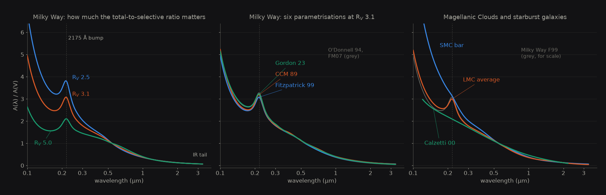
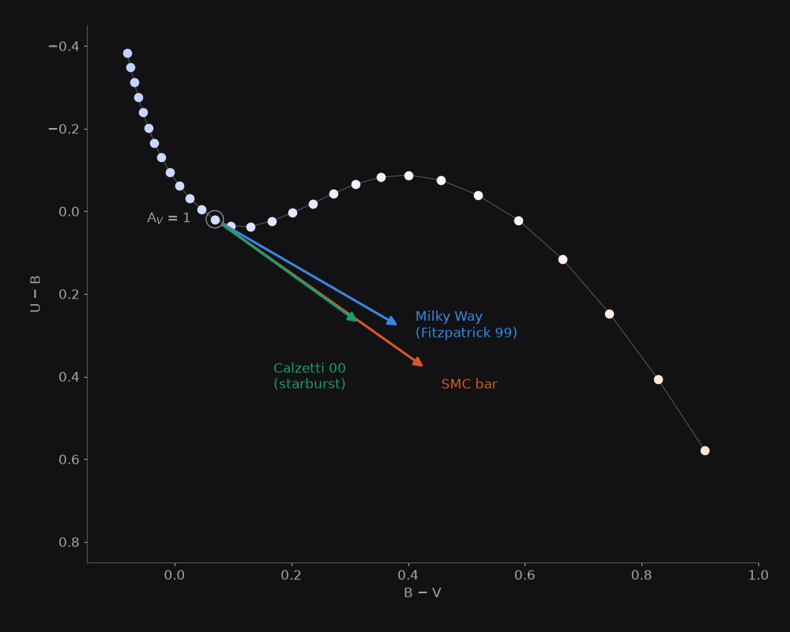

# Extinction

`sed_model.sed_extinction` is a self-contained, pure-NumPy implementation of interstellar dust extinction — no `dust_extinction`, `extinction`, or `astropy` dependency.

## Supported laws

The laws are a NumPy port of the extinction module of the MESA `colors` code and agree with it to about 1e-12 in \(k = A(\lambda)/A(V)\). The coefficients follow the `dust_extinction` package (Gordon 2024, JOSS 9, 7023) and, for FM07, the `extinction` package (Barbary 2016).

| Key | Reference | \(R_V\) | Fitted range |
|---|---|---|---|
| `ccm89` | Cardelli, Clayton & Mathis (1989), ApJ 345, 245 | 2 to 6 | 1000 Å to 3.3 µm |
| `odonnell94` | O'Donnell (1994), ApJ 422, 158 (CCM89 with a refitted optical section) | 2 to 6 | 1000 Å to 3.3 µm |
| `fitzpatrick99` | Fitzpatrick (1999), PASP 111, 63; the package default | 2 to 6 | 1000 Å to 3.3 µm |
| `fm07` | Fitzpatrick & Massa (2007), ApJ 663, 320 | 3.1 fixed | 910 Å to 6 µm |
| `gordon23` | Gordon et al. (2023), ApJ 950, 86, Milky Way (`gordon23_env="mw"`) | 2.3 to 5.6 | 912 Å to 32 µm |
| `g03_smcbar` | Gordon et al. (2003), ApJ 594, 279, SMC bar average | 2.74 fixed | 1000 Å to 3.3 µm |
| `g03_lmcavg` | Gordon et al. (2003), ApJ 594, 279, LMC average | 3.41 fixed | 1000 Å to 3.3 µm |
| `calzetti00` | Calzetti et al. (2000), ApJ 533, 682; starburst attenuation, \(A_V = R_V \, E(B\!-\!V)_s\) | default 4.05 | 1200 Å to 2.2 µm |

`calzetti00` is not in MESA and is unchanged. The tuple `sed_model.AVAILABLE_LAWS` lists the keys programmatically.



*A(λ)/A(V) for the laws: the effect of R_V, the Milky Way laws at R_V = 3.1, and the Magellanic and starburst laws.*

### \(R_V\)

- `fm07`, `g03_smcbar` and `g03_lmcavg` have a fixed shape and ignore `r_v`.
- For `ccm89`, `odonnell94`, `fitzpatrick99` and `gordon23` (Milky Way) an `r_v` outside the calibrated range in the table raises `ValueError` when the `ExtinctionConfig` is built or the law function is called, because the fits can go negative and brighten the star. `a_v < 0` also raises `ValueError`.
- `calzetti00` is not range-checked.

### Outside the fitted range

Longward of the fitted range each law continues its own functional form, which tends to zero as the wavelength goes to infinity. Shortward of the blue limit \(k\) is held at its value there (1000 Å for CCM89, O94, F99 and the two G03 laws; 910 Å for FM07; 912 Å for G23), since the far-UV fits diverge beyond it.

### `gordon23` environments

`gordon23_env="mw"` is the G23 Milky Way relation described above. G23 has no LMC or SMC curve, so `"lmc"` and `"smc"` are not G23: they are the older curves this package used in earlier versions (an FM90-style UV curve with an ad hoc power law beyond 3 µm). They are kept for compatibility, could not be checked against any reference implementation, and emit a `UserWarning`. Use `g03_lmcavg` and `g03_smcbar` for the Magellanic Clouds.

## Usage

```python
from sed_model import make_extinction_model, ExtinctionModel

ext = make_extinction_model(
    enabled=True,
    law="gordon23",
    a_v=0.8,
    r_v=3.1,            # ignored by fm07, g03_smcbar and g03_lmcavg; range-checked otherwise
    gordon23_env="mw",  # "mw", "lmc", or "smc" — gordon23 only
)

a_lambda  = ext.extinction_curve(wavelengths)   # A(λ) in magnitudes
reddened  = ext.apply(wavelengths, flux)      # F · 10^(−0.4 A)
deredden  = ext.remove(wavelengths, flux)     # F · 10^(+0.4 A)
```

A disabled model (`enabled=False`, or `make_extinction_model()` with no arguments) passes flux through unchanged — so you can keep a single code path and toggle extinction by configuration.

In the forward model, pass the model via `run_forward(..., extinction=ext)`; it is applied after distance dilution and before filter convolution. `bol_flux` and `bol_mag` in the result are those of the unreddened SED.

<video controls loop muted playsinline width="100%">
  <source src="../assets/gallery/dust.mp4" type="video/mp4">
</video>

*A 7000 K star reddened by A_V from 0 to 3 with the Fitzpatrick (1999) law.*



*A_V = 1 under three laws, from a 9000 K star.*

## Extinction in the inverse fit

When the [`FitParams`](parameters.md) makes `Av` **free**, the likelihood rebuilds the extinction model at each MCMC step with the proposed `Av` value (preserving your chosen `law`, `r_v`, and `gordon23_env`). The `a_v` stored on the `ExtinctionModel` you pass in is only a placeholder in that case.

If `Av` is active and you don't supply an extinction model, `run_inverse` creates a Fitzpatrick (1999), \(R_V = 3.1\) model automatically.

The [Extinction Comparison demo](../demos/extinction-comparison.md) fits the same synthetic observations once per prescription (including the Gordon environments and non-standard \(R_V\) values) to show how the choice of law propagates into the recovered parameters.
